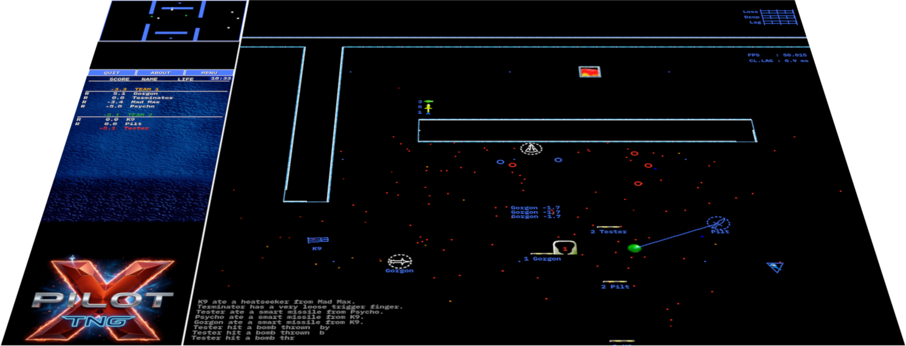

# 🚀 XPilot TNG (The Next Generation) 🛸
### *The 90s cult classic returns — dust-free, turbocharged & powered by SDL3!*

> *"In space, no one can hear you scream... but across university computer labs in 1994, everyone knew who just ate a cluster nuke."*

<p align="center"></p>

---

## 🛰️ What is XPilot TNG?

Welcome to **XPilot TNG** — the resurrection of one of the most legendary 2D multiplayer space dogfight games in computer history!

First conceived in 1991 by Bjørn Stabell and Ken Ronny Schouten, XPilot reliably brought down university subnets, hijacked dormitory networks, and dominated office LAN parties throughout the 1990s and early 2000s. After years of dormancy — bogged down by ancient 2006 GNU Autotools, obsolete C89 prototypes, and libraries that now belong in computer museums — the codebase has been thoroughly modernized:

- 🏎️ **No more Autotools headaches:** Rebuilt with a modern **CMake** & **Ninja** build system.
- 🦾 **C23 & GCC 15 Ready:** Pure, type-safe C code, UTF-8 clean, and stripped of deprecated syntactic fossils.
- 🎨 **SDL3 & GPU 2D Renderer:** Say goodbye to vintage OpenGL 1.1 immediate mode (`glBegin`/`glEnd`) and obsolete GLU. Crisp 2D vector rendering powered directly by `SDL_Renderer` with native Wayland and X11 support.
- 🔊 **Modern Sound:** Crisp audio effects delivered through native **SDL3 Audio Streams**.
- 🌐 **Modernized Networking:** Clean, thread-safe POSIX sockets (`getaddrinfo`, `getnameinfo`, `sockaddr_storage`) replacing archaic `SIGALRM` DNS timeouts from the 90s. Game traffic itself is still **IPv4 only** for now — full IPv6 is on the to-do list. 🚧
- 🛡️ **Hardened Server:** Three decades of `strcpy` optimism met a fuzzer and lost. Buffer overflows are fixed, the network code is sanitizer-tested and the binary is built with modern compiler hardening. Old clients still connect just fine — they just won't be able to crash your lobby anymore.

---

## 🎮 New game features

- 🤖 **Smartbots**: Strong AI-powered robots that will make you suffer (see below)
- 🚀 **Launcher**: A cool new launcher app for both client and server. 
- 🎧 **Voice chat**: Bark orders at your team over crackling radio, or trash-talk everyone within earshot — headset not included.
- 🤝 **Teamplay**: Better team selection and balancing, now with robots on your side — or against you. Try Blood's Music against a smartbot team if you dare.
- 🐣 **Newbie mode**: Finally repaired after 30 years — now you can learn to fly without being fed to the cannons on day one.
- 🗺️ **Map editor**: Draw your own battlefields: bases, fuel depots and cannons placed by click; every map option at your fingertips. No more counting ASCII characters.
- 🏁 **Highscores**: Race maps and ballruns (e.g. bloods-smartbots) now keep a hall of fame — only humans count, so the bots can't hog the podium.
- 📡 **Lag countermeasures** (experimental): For smoother gamplay a jitter buffer - it doesn't wait for the server's opinion.

---

## 📖 Background

I'm an old XPilot player (Sri Synadasti back in the days), and after almost 30 years I wanted to fly a few rounds with my kids. The catch: none of the available versions still works. What a pity — it was such a cool game! So I rolled up my sleeves and (mostly) brought it back to life. It's work in progress, and there are still some more fresh ideas waiting in the hangar...

---

## 🛠️ Prerequisites & Dependencies

To build XPilot TNG, all you need is a modern C compiler and a handful of standard libraries:

- **C Compiler:** GCC 13+ or Clang 16+ (fully tested with GCC 15 & C23)
- **Build Tools:** `cmake` (>= 3.25) and `make` (or `ninja`)
- **Libraries:**
  - `SDL3` and `SDL3_ttf` (for windowing, input, sound & text rendering)
  - `zlib` (for map compression)
  - `expat` (for XML maps and configurations)
  - `opus` (optional, for voice chat; without it the client builds without voice, or let CMake fetch it with `-DFETCH_OPUS=ON`)


---

## 🚀 Building & Compiling

The project builds with a simple `make` command (which wraps CMake) or directly with CMake:

### Option A: Simple Make (Recommended)
```bash
make -j$(nproc)
```

### Option B: Direct CMake
```bash
# 1. Configure build files (uses Ninja if installed with -G Ninja, otherwise Make)
cmake -B build

# 2. Compile (Server, Client & Libraries)
cmake --build build -j$(nproc)
```
*(Tip: If you have Ninja installed, you can pass `-G Ninja` for even faster builds).*

The resulting binaries will be right inside `build/` (and symlinked directly into the project root):
- `./xpilot-tng-server` (or `build/xpilot-tng-server`)
- `./xpilot-tng-client` (or `build/xpilot-tng-client`)

### Windows release (cross-compiled on Linux)
Needs MinGW-w64 with the POSIX thread model (Debian/Ubuntu: `sudo apt install g++-mingw-w64-x86-64-posix`), `git` and `zip`:
```bash
./build_win.sh
```
The first run downloads and statically builds SDL3, SDL3_ttf, Opus, zlib and expat. The result is `Xpilot-TNG_windows.zip`: self-contained `.exe` files (no DLLs) next to `lib/`. Unpack it anywhere and start `xpilot-tng-launcher.exe`. Settings are stored in `%APPDATA%\xpilot-tng\`, learned bot data in `%LOCALAPPDATA%\xpilot-tng\`.

---

## 🎮 Quickstart: Jumping into Battle

The easiest way to fly is the graphical **launcher**. It starts the server and the client for you, so there is no command line involved:

```bash
./xpilot-tng-launcher
```

### Play against bots

1. Click **Start Local Game** (or press `L`).
2. Pick a map on the left, for example the classic *New Dark Hell*, and set your name, ship and the number of bots on the right. Smartbots are in there, too.
3. Press **PLAY**. The launcher starts a local server, connects your client, and you are strapped into the cockpit.

### Play with others

- **Join Network Game** (`J`) lists servers in your local network and on the internet. Pick one and fly.
- **Launch Server** (`S`) hosts a game for friends. It can also register at the meta server. See [Hosting an internet server](doc/HOWTO-INTERNET-SERVER.md) for port forwarding and public setup.

... and **BOOM!** You are surrounded by asteroids, fueling bases, and trigger-happy bots!

---

## 🕹️ Newby Flight Academy: Piloting Your Ship

XPilot models **Newtonian space physics and inertia**. When you hit the thrusters, you keep gliding until counter-thrust slows you down — or until you become one with a solid granite wall!

| Key | Action | Pilot Survival Tip |
| :--- | :--- | :--- |
| **Left Shift** / **Right Mouse** | **Thrusters (Thrust)** | Feather it! Continuous thrust will turn you into a high-speed projectile heading straight for a wall. |
| **Left / Right Arrows** | **Rotate / Steer** | Point your ship toward where you want to shoot — which isn't always the direction you're flying! |
| **Spacebar** / **Left Mouse** | **Main Cannons (Fire)** | Cannon shots inherit your ship's momentum. Leading your targets is essential! |
| **s** | **Shields** | Absorbs hostile fire, but drinks your fuel tank like a thirsty black hole. |
| **Tab** | **Lock Target** | Acquire a missile lock on your nemesis. |
| **m** | **Launch Missile** | Send a high-explosive greeting card to whoever is on your tail. |
| **c** | **Cloaking Device** | Go invisible to human eyes (and confuse most bots). |
| **d** | **ECM (Electronic Jammer)** | Scrambles enemy radar, HUDs, and missile tracking. |
| **p** | **Phasing Device** | Pass right through solid rock walls — just don't run out of energy while inside a mountain! |
| **f** | **Refuel** | Hover near a green fuel depot. An empty tank means you're just target practice. |
| **F11** | **Fullscreen Toggle** | Switch between windowed mode and fullscreen. |
| **F12** | **Sidebar Toggle** | Toggle the left sidebar (radar & scoreboard) on/off to expand the playfield across the entire screen. |
| **Escape** | **Pause / Menu** | When your boss or professor suddenly walks into the room. |

📚 **Complete Controls & Weapons Reference:**
- ⌨️ [**Keyboard Controls Cheat Sheet**](doc/CHEATSHEET-KEYS.md) — Full list of all default flight, weapon, utility, and communication key bindings.
- 🚀 [**Weapons & Items Cheat Sheet**](doc/CHEATSHEET-WEAPONS.md) — Illustrated guide to primary guns, missiles, nuclear/cluster modifiers, and defensive devices.

---

## 🤖 Hostile Intelligence: The Smartbots

Behind the scenes, mainly because there are so few players around nowadays, the server now runs a cunning bot AI that can be activated. The old bots are still there, but smartbots play much stronger:

- They compute predictive ballistic deflection firing solutions.
- They bounce shots off walls with billiards-grade geometry.
- They sense when your fuel is low and swarm in for the kill.

Give them hell, or join forces with them in team-play mode! Ball-games against pure smartbot teams are possible, but the guys still have to learn that a bit better.

📖 **For detailed usage, configuration options, in-game chat commands, and AI architecture, see the [Smartbots Documentation](doc/SMARTBOTS.md).**

---

## 📜 License & Credits

XPilot TNG is released under the **GNU General Public License v2 (GPLv2)**.

- **Original XPilot Authors:** Bjørn Stabell, Ken Ronny Schouten, Bert Gijsbers, Dick Balaska, Kristian Söderblom, Uoti Urpala, Erik Andersson, and many open-source contributors.
- **XPilot TNG Modernization (2026):** Ported to CMake, C23/GCC 15, SDL3 GPU 2D rendering, SDL3_ttf & modern POSIX networking.

---

## 🔗 Historic XPilot Projects & Community Links

For enthusiasts, historians, and retro space aces seeking original archives, repositories, guides, and community lore:

### 🏛️ Classic Hubs & Source Repositories
- 🌐 [**XPilot.org (Official Classic Website)**](http://www.xpilot.org) ([Wayback Archive](https://web.archive.org/web/20050205004739/http://www.xpilot.org/)) — The original web hub featuring historical FAQs, world rankings, and map collections.
- 🛸 [**XPilot NG Project on SourceForge**](https://sourceforge.net/projects/xpilot-ng/) & [**Website**](http://xpilot.sourceforge.net/) — The prominent 2000s branch that introduced SDL/OpenGL, polygonal maps (`.xp2`), and HUD enhancements.
- 📦 [**XPilot NG GitHub Mirror**](https://github.com/jwr/xpilot-ng) — Preserved Git mirror of the XPilot NG SVN repository.
- 💾 [**Classic XPilot on SourceForge**](https://sourceforge.net/projects/xpilot/) — The original SourceForge repository hosting historical XPilot 4.5.x releases and patches.
- 📁 [**Local Legacy Trees (`legacy/`)**](legacy/) & [**Legacy Documentation (`doc/OLD_DOCS.md`)**](doc/OLD_DOCS.md) — Preserved, compilable copies of `xpilot-classic-4.5.5` and `xpilot-ng-4.7.3` included directly inside this repository.

### 📖 History, Guides & Community Lore
- 📚 [**Wikipedia: XPilot**](https://en.wikipedia.org/wiki/XPilot) — Comprehensive overview of the game's 1991 inception at the University of Tromsø, development history, and reception.
- 🎓 [**Jarno's Unofficial XPilot Newbie Guide**](https://web.archive.org/web/20070216124707/http://www.j-a-r-n-o.nl/newbie/) — The quintessential flight academy manual covering Newtonian maneuvers, dodge maneuvers, and ballistics.
- 🏆 [**XPilot Tournament & Teamcup Archives**](https://web.archive.org/web/20050212003730/http://www.xpilot.org/tournaments/) — Historical records of the European Team Cups, Spring Teamcup, Death Cup, and clan wars.
- 📼 [**Vipa's Ballrun Archive & Match Replays**](https://web.archive.org/web/20050212003740/http://www.xpilot.org/replays/) — Match recordings (`.xpr`) featuring legendary ball runners and tournament tactics.
- 💬 [**rec.games.computer.xpilot (Usenet Newsgroup)**](https://groups.google.com/g/rec.games.computer.xpilot) — Decades of Usenet discussions, server announcements, and tactics from the 1990s and 2000s.

### 🚀 Modern Spin-Offs & AI Research
- 🌐 [**WPilot (HTML5 Web Remake)**](https://github.com/jfd/wpilot) — The open-source browser remake using HTML5 Canvas and WebSockets inspired directly by XPilot.
- ♾️ [**XPilot Infinity**](https://github.com/kekyo/xpilot-infinity) — Another fork of XPilot NG modernized for current systems, with SDL3/OpenGL graphics, sound, and TCP/WebSocket transports.
- 🧠 [**XPilot-AI**](https://github.com/mit-ll/xpilot-ai) — MIT Lincoln Laboratory's autonomous AI agent research and competition platform built on XPilot.

---

*Fly fast, shoot straight, and always remember: Gravity never negotiates.* 🚀💥
