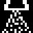
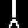
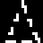

# XPilot TNG – Weapons & Items Cheat Sheet

Keys are the defaults (see `CHEATSHEET-KEYS.md`). Item availability and quantities depend on the map/server (`initialMines`, `maxMissiles`, etc.).

Icons are the in-game item pickup symbols (16×16 XBM from `src/client/items/`, shown 3× enlarged, white on black as in the game). Smart missiles, heat-seekers and torpedoes share one pack icon (`itemRocketPack`); the basic shot, shield and modifiers have no item icon. PNG copies live in `doc/img/items/`.

## Primary weapons

| Icon | Weapon | Key | Notes |
|---|---|---|---|
| – | **Shot** | `Enter` | Basic bullets. Shield must be down. Costs a little fuel. |
|  | **Wide-angle** (item) | auto | Each item adds an extra shot fanning to the sides. |
|  | **Rear shot** (item) | auto | Each item adds a shot fired backwards. |
|  | **Afterburner** (item) | auto | Boosts thrust power (more fuel use). |
|  | **Laser** (item) | `/` | Instant beam; stun/blind with laser modifier (`L`). Beam can be reflected by mirrors. |

## Missiles & ordnance

| Icon | Weapon | Key | Notes |
|---|---|---|---|
|  | **Smart missile** | `\` | Homes on your current lock; can be fooled by ECM. |
|  | **Heat-seeker** | `;` | Chases engine heat (thrusting ships). Ignores cloak. |
|  | **Torpedo** | `'` | Unguided, accelerating, powerful. |
|  | **Mine** | `Tab` drop, `]` detach, `=` detonate | Dropped mines stay put; detached mines drift with your velocity. Can be detonated remotely. |
|  | **ECM** | `[` | Shockwave: jams missiles, blinds/disrupts nearby ships' locks and mines. |

> Missiles, torpedoes, heat-seekers and mines all draw from the **missile / mine** inventories and are affected by the modifiers below.

## Weapon modifiers (apply to missiles/mines/shots)

| Modifier | Key | Effect |
|---|---|---|
| **Nuclear** | `N` | Huge explosion (consumes extra ammo, big blast). |
| **Cluster** | `C` | Explodes into many fragments (combines with Nuclear for "full nuke"). |
| **Implosion** | `I` | Explosion pulls debris/ships in instead of pushing out. |
| **Velocity** | `V` | Explosion fragments get extra speed. |
| **Mini** | `X` | Fires several small weapons per press. |
| **Spread** | `Z` | Spreads mines/missiles in a fan. |
| **Power** | `B` | Increases warhead power. |
| **Laser** | `L` | Laser mode: stun / blinding beam. |
| Clear | `K` | Reset modifiers. Banks `1–4` load saved sets; `` ` `` reprograms. |

## Defensive / utility items

| Icon | Item | Key | Effect |
|---|---|---|---|
| – | **Shield** | `Space` | Protects from damage; drains fuel when hit. Can't fire while up. |
|  | **Emergency shield** | `Caps Lock` | Temporary invulnerable shield. |
|  | **Deflector** | `O` | Pushes nearby shots/missiles away. |
|  | **Armor** | auto | Absorbs one hit that would kill you. |
|  | **Cloak** | `Del`/`Backspace` | Invisible to others and to scanners; uses fuel. |
|  | **Mirror** | auto | Reflects lasers. |
|  | **Phasing** | `P` | Pass through walls and shots for a short time. |
|  | **Hyperjump** | `Q` | Random teleport on the map. |
|  | **Sensor** | auto | Extends radar visibility (shows cloaked/hidden ships). |
|  | **Autopilot** | `9` | Stabilises/brakes ship when engaged. |
|  | **Emergency thrust** | `J` | Short burst of extra thrust. |
|  | **Fuel tank** | `E` / `W` / `R` | Extra fuel capacity; cycle with `E`/`W`, jettison with `R` (jettisoned tank explodes as a hazard). |
|  | **Transporter** | `T` | Steals an item from a nearby ship. |
|  | **Tractor / pressor beam** | `,` / `.` | Pulls or pushes an enemy/object (drains fuel). |

## Other mechanics

| Action | Key | Notes |
|---|---|---|
| Refuel | `F` / `Ctrl` | Hover over fuel station. |
| Repair target | `F` | Repair target block. |
| Ball connect/drop | `F` / `D` | Treasure/ball games. |
| Self-destruct | `End` | Toggle countdown. |
| Lose item | `KP 0` select, `KP .` drop | Discards item (e.g. to get rid of unstable nuclear stock). |

> [!NOTE]
> Exact damage, fuel costs and limits are map/server settings. Verify specifics with `src/server/cmdline.c` (`initial*`, `max*` options).
