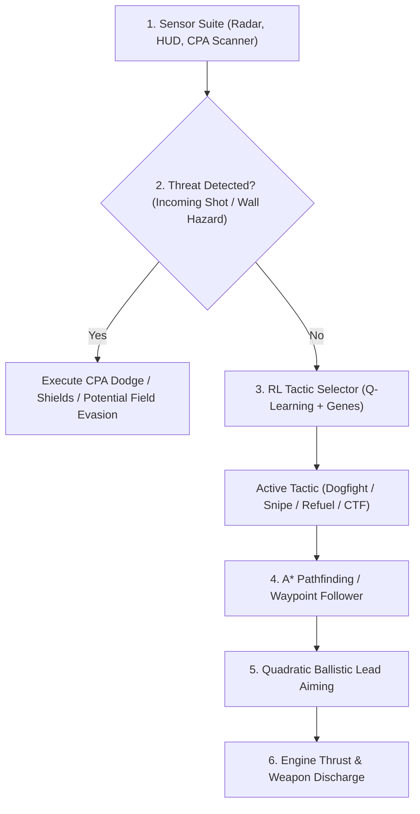

# 🤖 XPilot TNG Smartbots Documentation

XPilot TNG introduces **Smartbots** (`smart`), an advanced autonomous AI driver built into the game server (`src/server/smartbot.c`). Unlike classic scripted bots, Smartbots combine **exact ballistic lead prediction**, **A\* grid pathfinding**, **potential field collision evasion**, and a **hybrid online Reinforcement Learning (RL) brain** with persistent learning across server sessions.

---

## Table of Contents

1. [Overview & Features](#overview--features)
2. [Server Configuration & Startup Options](#server-configuration--startup-options)
3. [The Smartbot Roster](#the-smartbot-roster)
4. [In-Game Chat Commands](#in-game-chat-commands)
5. [AI Architecture & Core Capabilities](#ai-architecture--core-capabilities)
   - [Quadratic Ballistic Lead Prediction](#quadratic-ballistic-lead-prediction)
   - [Threat Scanner & CPA Evasion](#threat-scanner--cpa-evasion)
   - [A* Grid Pathfinding](#a-grid-pathfinding)
   - [Potential Field Maneuvering](#potential-field-maneuvering)
   - [Race Maps](#race-maps)
   - [Ball Game: Handling, Delivery & Team Play](#ball-game-handling-delivery--team-play)
6. [Ball Game Bots (`ball` driver)](#ball-game-bots-ball-driver)
7. [Race Bots (`race` driver)](#race-bots-race-driver)
8. [Reinforcement Learning & Shared Brain](#reinforcement-learning--shared-brain)
   - [State & Action Space](#state--action-space)
   - [Evolutionary Policy Genes](#evolutionary-policy-genes)
   - [Rewards](#rewards)
   - [Brain Persistence (`smartbot_brain.dat`)](#brain-persistence-smartbot_braindat)
9. [Skill Level Matrix (Levels 1–100)](#skill-level-matrix-levels-1100)
10. [Tactical Advice for Human Pilots](#tactical-advice-for-human-pilots)

---

## Overview & Features

Classic XPilot robots rely on simple line-of-sight heuristics and fixed reaction timers. XPilot TNG Smartbots are engineered for modern competitive gameplay:

- **Mathematical Aiming:** Solves quadratic intercept equations factoring in relative vessel velocities, projectile speed, gravity, and toroidal world wrap.
- **Dynamic Threat Assessment:** Computes the *Closest Point of Approach (CPA)* for incoming bullets, smart missiles, and torpedoes to initiate micro-dodges and shield deployments.
- **Topological Navigation:** Navigates labyrinthine polygon and block maps using bounded grid A\* pathfinding to reach fuel stations, items, and team objectives.
- **Tactical Versatility:** Dynamically shifts between close-quarters dogfighting, long-range sniper kiting, survival evasion, harvesting/refueling, and CTF flag-running.
- **Team Ball Play:** Tows the ball as a pair (ship + ball) instead of just flying the ship, throws it into the goal in a swing manoeuvre, and plays as a team with roles (attacker, defender, escort, hunter).
- **Dedicated Ball Game Driver:** On team maps with treasures, smart robots use a separate driver (`ball`, `src/server/ballbot.c`) that plans its flight with a physics model of ship and ball (see [Ball Game Bots](#ball-game-bots-ball-driver)).
- **Dedicated Race Driver:** On race maps (timing mode with checkpoints), smart robots use the `race` driver (`src/server/racebot.c`), which plans the racing line with a physics model and manages laps and fuel (see [Race Bots](#race-bots-race-driver)).
- **Online Learning:** Uses Tabular Q-Learning and continuous evolutionary policy adaptation that learns from combat outcomes (kills, deaths) and ball-game results, and persists across server runs in `smartbot_brain.dat`.

---

## Server Configuration & Startup Options

Smartbots can be enabled via command-line arguments or server defaults files (`defaults`):

### Server Options

| Option | Command Line Alias | Default | Description |
| :--- | :--- | :---: | :--- |
| `maxSmartRobots` | `-smartRobots` | `0` | Number of smart learning robots wanted. Only robots are counted, human players do not reduce it. With `botsMatchHumans` it only sets the ratio of normal to smart bots. |
| `minSmartRobots` | `-minSmartRobots` | `-1` | Minimum number of smart robots kept in the server (`-1` = follow `maxSmartRobots`). |
| `smartRobotLevel` | `-smartLevel` | `75` | Global skill and intelligence level (**1 to 100**). Controls aiming precision, pathfinding depth, turn rate, and several ball-handling skills (see [Skill Level Matrix](#skill-level-matrix-levels-1100)). |
| `smartRobotsLaser` | `-smartRobotsLaser` / `-smartLaser` | `true` | When `false`, Smartbots will neither pick up nor use laser pulses. |
| `robotsFillTo` | `false` | Humans replace bots: the game is filled up to `maxRobots + maxSmartRobots` players in all (4 bots wanted, two humans: two bots). See [TEAMPLAY.md](TEAMPLAY.md). The race maps *grandprix* and *zandvoort* turn it on with 4 race bots at level 50. |
| `smartBotType` | `-smartType` | `auto` | Which AI the smart robots use: `auto` (the ball driver on team maps with treasures, the race driver on race maps, the learning smartbot elsewhere), `smart` (always the learning smartbot), `ball` (the ball driver on every map; without a ball game it only dogfights, see below) or `race` (the race driver on race maps, the learning smartbot elsewhere). Affects robots that join afterwards. The launcher offers the choice as a dropdown next to the number of smartbots. |

### Example Startup Commands

```bash
# 1. Start server with 4 Smartbots at default veteran skill (Level 75)
./xpilot-tng-server -map lib/maps/ndh.xp2 -smartRobots 4 -noQuit

# 2. Host a brutal training session with 6 Grandmaster Smartbots (Level 95)
./xpilot-tng-server -map lib/maps/ndh.xp2 -smartRobots 6 -smartLevel 95 -noQuit

# 3. Mix classic robots with smart learning bots
./xpilot-tng-server -map lib/maps/ndh.xp2 -robots 3 -smartRobots 3 -noQuit
```

> [!NOTE]
> Bots are only added while there are free bases, and with `restrictRobots` also only while the bot team has free bases. `maxRobots` and `maxSmartRobots` count robots only; human players do not count against them.

> [!TIP]
> If human players leave, setting `-noQuit` keeps the server running so Smartbots can continue training against each other in the background.

---

## The Smartbot Roster

When spawned, Smartbots are assigned distinct names, custom ship geometries, and initial combat biases:

| Bot Name | Base Aggression / Defense | Ship Specialty |
| :--- | :---: | :--- |
| **`AlphaPilot`** | 90 / 80 | Balanced strike fighter with high turn agility |
| **`DeepThought`** | 75 / 85 | Defensive heavy hull; excels at sniper kiting |
| **`SHODAN`** | 95 / 75 | Aggressive hunter with high speed pursuit bias |
| **`HAL-9000`** | 80 / 90 | Methodical interceptor; prioritizes tactical positioning |
| **`Cortana`** | 85 / 80 | Swift dogfighter with reactive shield usage |
| **`Wintermute`** | 88 / 72 | High-speed flanking vessel |
| **`Siri`** | 82 / 88 | Defensive support craft and flag escort |
| **`GLaDOS`** | 70 / 95 | Fortified defensive tank; lethal counter-attacker |
| **`Skynet`** | 96 / 70 | Relentless forward assault drone |
| **`Ultron`** | 92 / 78 | Frontline brawler favoring close-range strafing |
| **`DeepMind`** | 86 / 86 | Highly adaptive tactical all-rounder |
| **`OmegaZero`** | 90 / 85 | High-velocity interceptor |

---

## In-Game Chat Commands

Players can interact with, inspect, and configure Smartbots in real-time through the in-game chat interface by sending private messages (default key: `m` or `/msg <BotName>`):

```text
/msg <BotName> status
/msg <BotName> level <1-100>
/msg <BotName> level 0
/msg <BotName> save
/msg <BotName> learn on
/msg <BotName> learn off
```

### Command Details

- **`/msg <BotName> status`**  
  Displays live diagnostics in the client console:
  - Effective skill level and individual override status.
  - Current tactical mode (`Dogfight`, `Snipe/Kite`, `Evade`, `Harvest/Fuel`, or `CTF`).
  - Total learning episodes completed.
  - Kill / Death ratio.
  - Current preferred combat distance.

- **`/msg <BotName> level <1-100>`**  
  Overrides the bot's skill level individually without affecting other bots on the server.
  *(Example: `/msg SHODAN level 100`)*.

- **`/msg <BotName> level 0`**  
  Resets the bot back to the global server `smartRobotLevel`.

- **`/msg <BotName> save`**  
  Immediately flushes and writes the shared reinforcement learning Q-table and evolutionary genes to `smartbot_brain.dat`.

- **`/msg <BotName> learn on` / `learn off`**  
  Enables or disables online reinforcement learning updates for this bot. Setting `learn off` forces pure exploitation of learned strategies.

---

## AI Architecture & Core Capabilities

Smartbots utilize a hierarchical decision pipeline executed every game tick:



### Quadratic Ballistic Lead Prediction

Rather than firing at an opponent's current location, the bot solves the interception equation:

$$\|\vec{r} + \vec{v}_{\text{rel}} \cdot t\|^2 = (v_{\text{projectile}} \cdot t)^2$$

Where:
- $\vec{r}$ is the relative displacement vector (adjusted for world wrapping).
- $\vec{v}_{\text{rel}} = \vec{v}_{\text{target}} - \vec{v}_{\text{shooter}}$.
- $v_{\text{projectile}}$ is the muzzle velocity (`options.shotSpeed` or `options.pulseSpeed`).

The solver computes the earliest positive root $t$. If the calculated intercept trajectory intersects a solid obstacle, higher-level bots abort the shot or maneuver into a clear line of sight.

### Threat Scanner & CPA Evasion

The Closest Point of Approach (CPA) scanner runs continuously:
- Evaluates trajectories of all active missiles, torpedoes, and cannon shots within sensor radius.
- Predicts whether an incoming hazard will enter the bot's collision bounding radius within $N$ frames.
- If an imminent hit is detected, the bot applies orthogonal thruster impulses and pulses emergency shields.

### A* Grid Pathfinding

On labyrinthine maps, direct vector flight leads to wall collisions. Smartbots implement a bounded grid A\* search:
- Discretizes the map into traversal blocks.
- Identifies paths around dead ends and narrow corridors.
- Caches up to 32 sequential waypoints for smooth navigation toward refueling depots, friendly home bases, or enemy treasures.

### Potential Field Maneuvering

Movement combines attractive and repulsive force vectors:
- **Attractive Vector:** Pulls the vessel toward the target or current A\* waypoint.
- **Wall Repulsion:** Increases exponentially as the bot approaches solid terrain.
- **Hazard Repulsion:** Pushes the bot away from floating mines, cannon fire, and asteroid fields.

### Race Maps

With `smartBotType` `smart` the learning smartbot races too, just not well. Its bounded A\* gets lost on long winding tracks, so on race maps it follows one distance field per checkpoint, computed once over the whole map with the checkpoint's disk as the goal. Blocks next to walls and in strong gravity cost more, so the way keeps to the middle of the track. It flies at the farthest point along that way it can see without crossing strong gravity; the repelling gravs in the corners of *Grand Prix* would otherwise trap it. Its combat, dodging and shields work as everywhere else. A lap takes it about twice as long as the [`race` driver](#race-bots-race-driver).

### Ball Game: Handling, Delivery & Team Play

This section describes the learning `smart` driver. With `smartBotType` `auto` (the default), ball maps use the [`ball` driver](#ball-game-bots-ball-driver) instead.

On team maps with treasures (balls), Smartbots play the ball game with dedicated flight control and team roles. Ships die on contact with a ball area (`treasureCollisionKills`), so a large part of this logic is about handling the ball without crashing.

#### Treasure box avoidance

- The outline of every ball area (the box around a treasure) is read from the map polygons and avoided exactly, with **no extra safety margin**: bots may fly closely past a box.
- Only the velocity component *towards* a box is limited, to what the ship can still brake away. The braking estimate includes the time to turn around (so low-level bots brake earlier) and the mass of a towed ball.
- Walls are still repelled block-wise, but ball areas are no longer treated as a block-sized wall. The path planner (A\*) routes around them.

#### Picking up the ball

- The connector arms as soon as the ship comes within `ballConnectorLength` of the ball, and the ball attaches when the ship moves out of that range again. The bot therefore flies to a free spot at about half that distance on its own side of the ball, never to the ball or the treasure centre.
- The connector is switched on only for a deliberate grab: the ball must be within reach **with a clear line to it**. It is never armed through a wall, which used to leave ship and ball stuck on both sides of it. If a towed ball still ends up behind a wall for about a second, the bot lets go and grabs it again.
- The bot grabs from the side where its chosen route home leaves the ball and pulls the ball out in that direction (see *Ball run routes* below).

#### Towing: flying a ship-and-ball pair

The ball is heavier than the ship and hangs on a stiff, barely damped spring, so steering the ship alone makes the pair jerk and oscillate. While towing, the bot therefore:

- flies the **centre of mass** of ship and ball, using the acceleration the pair really has (thrust / total mass),
- **plans the speed along the whole remaining path**: straight runs are flown fast, and the bot slows down early enough for every later turn,
- **damps the spring** by pulling away while the connector is compressed,
- keeps the **ball behind the ship** and never pushes towards it, except in an emergency; a small overspeed is simply coasted out,
- checks the **ball's path for walls** too, not only the ship's,
- limits its top speed with the skill level.

**Ball run routes:** for every pair "enemy treasure → own treasure" the server computes four clearly different routes once per map (logged with `logRobots`, about 25 ms per direction). Routes are searched on a half-block grid with 20 px wall clearance; further variants come from penalising a corridor around each route found, and routes running mostly inside the corridor of an accepted one are dropped. A route's quality is its estimated flight time with a towed ball, where every corner costs the time to slow down for it, so twisty routes rate badly even when they are short.

Before grabbing the ball the bot picks one route at random, weighted by quality (weight `(best time / time)²`), and routes with a visible enemy on them get almost no weight. Until the ball is grabbed it checks about once per second and picks again if an enemy shows up on its route. On `bloods-smartbots` the short route over the map edge is chosen a bit less than half of the time, each of the other three in roughly 15–20% of the runs.

**Enemies on the route (fine-tuning on the way):** route points are pushed up to 2.5 blocks away from enemies close to them. When the next route point is out of sight, the local path finder leads there; while towing, its path blocks within 6 blocks of visible enemies cost extra (up to four times the normal cost right next to an enemy), so the carrier gets around them. If the bot loses its route for about three seconds, it falls back to the plain path finder.

#### Scoring: the swing throw

- Once the ball has a clear line to the goal and the treasure is close (about 10 blocks), the bot starts a **throwing run**: the pair's centre of mass flies parallel to the line ball → goal while the ship swings 90° out to one side of the ball, towards the free side.
- The ball is released when its predicted flight path hits the goal and the ship is **not** in that path. The ball area is permeable for balls, so the ball only has to touch the goal.
- If the ball misses, the bot swings out sideways and starts a new straight run.
- After a throw the bot does not chase the ball again for a few seconds.

#### Team roles

Roles are assigned per team about once per second. A bot that already has a role is favoured, so roles do not flap. Human players are never assigned roles, but are covered as carriers.

| Situation | Roles |
| :--- | :--- |
| Own ball at home | **Attacker** (the bot closest to the enemy ball), from three bots on a **Defender**, up to two **Escorts** for the carrier or attacker, any further bots attack too. Stealing the ball comes first, so two bots are attacker and escort. |
| Own ball stolen or loose | Everybody becomes a **Hunter**; with 3 or more free bots one keeps attacking |
| Towing a ball | **Carrier** (always) |

- **Attacker:** fetches the enemy ball and only fights enemies that are directly in the way (closer than 6 blocks, in line of sight; never with the CTF tactic).
- **Defender:** circles the own treasure at about 4 blocks and fights enemies that come within 16 blocks of it.
- **Escort:** flies ahead of and beside the carrier, away from the trailing ball, and fights enemies that approach the carrier (within 18 blocks); an enemy carrier is pressed at close range.
- **Hunter:** intercepts the enemy carrier of the own ball, aiming at its predicted position, and attacks him at close range (3 blocks) as soon as he is in sight within 18 blocks; if the ball lies loose, it picks it up and brings it home with the same logic as the enemy ball.
- **Carrier:** flies the ball home. While the pair coasts (little thrust needed) and an enemy is within 12 blocks, it turns to it and fires, as human carriers do; as soon as real thrust is needed, flying has priority again.
- The RL tactic only sets the fighting style (dogfight distance, sniping). Escorts, defenders and hunters always fight in their area, because that is their job; with `TACTIC_CTF_OBJECTIVE` an attacker ignores fights completely.
- In ball games the RL does not use `TACTIC_EVADE_SURVIVE` or `TACTIC_HARVEST_REFUEL` unless fuel is low, and near walls no longer count as a "threat" for its state.

#### What a team knows (fairness)

Bots get no information a human team would not have. The radar shows only plain dots (no hint who carries a ball, balls only with `treasuresOnRadar`), and the server prints no message when a ball is picked up. The team knowledge is therefore limited to view range (`Visibility_distance`, the same range a human sees):

- **Own ball is away:** known as soon as any living teammate (human or bot) sees the empty treasure **or the ball anywhere** (loose or towed). It is remembered until a teammate sees the ball at home again.
- **Thief:** known only while a teammate sees him (cloaking hides him as for humans). Hunters chase him then; when nobody sees him any more they search for the loose ball instead.
- **Enemy ball at home:** assumed to be there until a teammate actually sees the enemy treasure. An attacker therefore simply flies to the enemy treasure, as a human would, and only learns on arrival if the ball is gone.
- **Own towing:** a team always knows which of its own members tows an enemy ball.

---

---

## Ball Game Bots (`ball` driver)

The `ball` driver (`src/server/ballbot.c`) is a second robot type made only for team ball games. Smart robots use it on maps with team play and treasures of at least two teams, when `smartBotType` is `auto` or `ball`. It does not learn; it plans. The robot names, the `S` marker and `smartRobotLevel` are shared with the smartbots.

### Map analysis

Done once per map (well under a second on a Raspberry Pi 4):

- **Clearance grid:** every map cell (BLOCK_SZ/5, 7 px on bloods) gets the exact distance to the nearest obstacle (Euclidean distance transform, wrap-aware). There are two grids: ships hit walls and ball areas, balls only walls.
- **Target zones:** the cells where a ball scores, grown by the ball radius, because the server scores as soon as the ball's edge touches the target.
- **Navigation grid:** one node per block at its most open point. Edges cost extra where clearance is low, more so for a ship towing a ball.
- **Distance fields:** Dijkstra fields to every treasure, for a ship alone and for a towing ship. Fields to moving goals are computed on demand, cached, and limited to three per tick.
- **Ball run routes:** up to four clearly different routes per treasure pair. Each alternative is forced through a via point in the middle of the run, away from the routes already found. The quality accounts for length and turns, and the choice is weighted by (best time / time)². A route with enemies on it is avoided, and the carrier switches route underway if enemies show up and another route is not a large detour.

### What the team knows

A team uses only what a human team that talks could know:

- Anything within a human's view range of a living teammate, humans included: ships, shots and balls.
- Enemy positions on the radar when `playersOnRadar` is on. Radar speed is estimated from consecutive positions.
- An own ball is known to be away when a teammate sees the empty treasure or the ball somewhere else.
- A thief is known only while a teammate sees him tow the ball, and remembered for a while after.

### Roles

Every half second each team assigns roles by priority, each to the cheapest free bot (with hysteresis). The ball run comes first: the `grab` task goes to whichever bot is closest to the enemy ball and not in a fight (each enemy within 300 px adds to its cost), with little hysteresis, so the grabber changes as the bots move. A supporter that gets close becomes the grabber, and the former grabber covers it.

| Role | Task |
| :--- | :--- |
| `carry` | Tow the ball home (whoever has it). |
| `return` | Ram our own loose ball. With `treasureCollisionDestroys` any ship touching a ball sends it home. |
| `hunt` | Our ball is stolen: ram the towed ball and shoot the thief. Intercepts on the thief's predicted way home; waits at his target if the thief is unseen. |
| `grab` | Fetch the enemy ball. A ball at rest is picked up in passing: the bot lines up on a free line beside the ball (about 105 px off) close to the run's start direction, connects as it passes and attaches at about 20 px/tick, so the pair leaves already moving. Without such a line it uses a connect spot with room to manoeuvre. It fights only an enemy right on it that no teammate is closer to, and leaves the enemy base faster than normal towing speed, because their ships respawn there. |
| `defend` | Guard the treasure between it and the main threat. Escorts our carrier while no enemy is near home. Comes before `support` only when a known enemy is near our base; a human teammate near our base takes this job. |
| `escort` | Stay behind the carrier towards the pursuers and engage enemies near him. |
| `support` / `mid` | Cover the grabber at the enemy base, or intercept in the middle. |

With nothing threatening our base, two bots both attack: grabber and supporter. Human carriers in the team are escorted like bot carriers.

### Flight: sampling model predictive control

Each tick a bot simulates about 60–100 candidate manoeuvres 16 ticks ahead (22 ticks when towing). A candidate is a heading with thrust or coast for a few ticks, followed by a built-in policy. The model is the server's own physics: thrust, turn rate, `constantSpeed`/`oldThrust`, and the ball on its spring connector (simulated per frame). Candidates are scored on:

- progress along the distance field (near the goal: the ball's straight distance to the target);
- clearance to walls and ball areas, and whether the bot can still stop or turn before the next wall;
- wall bounces: below `maxUnshieldedWallBounceSpeed` a ship only bounces (all `playerWallBounceType`s are modelled), a ball below `maxObjectWallBounceSpeed` too. A bounce costs the speed it loses and a little extra; touching a ball target kills the ship;
- connector strain (the rope must not snap). When towing, only the centre of mass counts: a swinging ball or one that leads costs nothing by itself;
- enemies reaching the towed ball: any ship touching it sends it home, so enemies are assumed to accelerate straight at it;
- enemy shots in view, checked continuously along each tick, and virtual shots of enemies that point at the bot;
- collisions with ships, and touching balls that must not be touched;
- aiming: turning towards the lead direction of the target and being on it in the next ticks.

The best plan is kept and offered again the next tick, so longer manoeuvres stay coherent.

**Towing** follows one rule: always pull, never push. The rope (ball → ship) is turned to point along the wanted acceleration: ball behind when speeding up, swung ahead for braking. A cascade sets the rope's angular speed from the angle error and the thrust angle from the angular speed error. The gains were tuned offline on a copy of the model.

**Scoring:** runs normally end with a throw. From about 1100 px out the carrier looks for a free straight line into the target (targets are often open to one side only) and first steers the ball to a gate 300 px out on that line, arriving with the ball moving along it. Near home (about 900 px) with a clear line from the ball to the goal, the rollouts reward a ball course that points closer at the goal. They reward highest any moment at which releasing the ball would let it fly into the target without hitting our own ship. The bot releases the ball as soon as its free flight would score and the ship can coast on without hitting the target. Towing the ball into the target also counts.

On xp2 maps ball targets are not linked to a treasure. A target belongs to the nearest treasure of its team.

On maps without a ball game (dogfight maps, no team play or no treasures of two teams) a `ball` bot has no ball roles. Every ballbot plays for itself, nobody counts as an ally, and each one hunts the nearest enemy it knows. The flight and combat code is the same, but there is no tactics beyond that, and `auto` keeps using the learning smartbot on such maps.

### Combat

The bot leads with the shot's inherited ship velocity. It fires when the shot would pass the target closer than the ship radius plus a margin (narrower at low levels), and only with a free line. Bots aim at the nearest enemy in view whenever it costs little, for example while coasting with a ball.

### Skill levels

| Effect | Level 30 | Level 75 | Level 100 |
| :--- | :---: | :---: | :---: |
| Turn rate (direction units per tick) | 5 | 9 | 12 |
| Reaction delay for enemy movement | ~4 ticks | ~1 tick | none |
| Aiming error (direction units) | ±2.8 | ±1 | 0 |
| Fire tolerance beyond the ship radius | 0 px | +2.5 px | +4 px |
| Extra wall margin | 6 px | 3.5 px | 2 px |
| Sampled headings | 8 | 16 | 16 |
| Towing speed limit | 16 | 18 | 19 |

### CPU usage

On a desktop CPU, 4 ball bots use about 1.6% and 8 ball bots about 3% of one core. Expect roughly 6–8 times that on a Raspberry Pi 4.

### Chat commands

- `/msg <bot> status`: skill level and current role.
- `/msg <bot> level N`: individual skill level (0 = global `smartRobotLevel`).

---

## Race Bots (`race` driver)

The `race` driver (`src/server/racebot.c`) is a robot type made for race maps: `timing` on, at least one checkpoint, no `ballrace`. Smart robots use it there when `smartBotType` is `auto` or `race`. It aims at the best lap times the physics allow, keeps to the set `raceLaps` and the fuel it has, and defends itself. Names, the `S` marker and `smartRobotLevel` are shared with the other smart robots.

### Map analysis

Once per map the walls are rasterized on a fine grid (about 7 px; polygon edges are traced as well, so thin walls have no gaps) and an exact distance transform gives the wall clearance everywhere. A navigation grid of one cell per map block carries the shortest paths.

For every checkpoint there are distance fields that do not stop at its disk (`checkpointRadius`): the disk's cells start with the cost of going on from there to the next checkpoints. The value of a position is the length of the way through the next checkpoint and the three after it. So passing a checkpoint is continuous in value, passing it at a bad spot costs exactly the way it wastes, and the paths of the deepest fields are the racing line: they cut through each disk where it sets up the next one. Near the finish the look-ahead ends with the race.

### Flight

Each tick the bot simulates about 130 candidate manoeuvres (about 85 below level 50) 40 ticks ahead: a heading with thrust or coast for 2–20 ticks, followed by a racing policy that flies at the farthest visible point of the racing line as fast as still allows slowing down for it. The model is the server's own physics, frame by frame: thrust, turn rate, `friction`, gravity of the map (repelling gravs at the corners of *Grand Prix* are part of the plan), `constantSpeed`, and wall bounces of every `playerWallBounceType`. The size of the ship comes from its shape. Candidates are scored on:

- the course value reached at the end, and the course value along the way (progress made early counts, otherwise a plan that dawdles looks as good as one that goes);
- checkpoint passes, judged against the disk as the server does; finishing earlier is worth more;
- wall bounces: they cost the speed they lose plus a little. Above `maxUnshieldedWallBounceSpeed` a bounce is only survivable with a shield and costs a lot; faster than the shield allows is a crash;
- enemy shots and virtual shots of attackers that point at the bot;
- enemy ships: touching one kills (`allowPlayerCrashes`) or costs `playerCollisionFuelDrain` fuel (`allowPlayerBounces`). Enemies may change course any moment, so the berth widens with the time ahead. This matters at the start, when all ships leave the grid together.

The best plan is kept and offered again the next tick.

### Laps and fuel

The bot counts the checkpoint passes left (`raceLaps` × checkpoints + the start). It measures the fuel each course segment uses. When the fuel left will not last for the rest of the race (with 10 % and 10 units to spare), it flies to the fuel station with the smallest detour, stops there and refuels until it has enough with a margin, then races on. Stations within reach on the way are always used in passing. Without measurements yet the need is estimated from the path lengths; the first lap corrects it.

### Defence

- Shots and ships are dodged by the flight model.
- The shield goes up (when the bot has one) against a hit or ram the best plan cannot avoid, and whenever the ship heads for a wall within two ticks at a speed only a shield survives.
- Players who shoot at the bot, push it or kill it count as attackers for a few seconds. The bot shoots back at them when the shot would hit and the line is free, and turns towards them only when it costs little. It does not start fights: racebots leave each other alone.

### Learning

Per map the bot keeps the fuel and the time of every course segment and its best lap in `$XDG_DATA_HOME/xpilot-tng/racebot/<map name>.txt` (default `~/.local/share/...`), keyed to the checkpoint layout. From the second race on its fuel planning uses what it measured, so it neither makes needless stops (*Zandvoort* starts with only 150 fuel) nor runs dry. A tuned corner speed per segment was tried as well, but made no measurable difference to the lap times, so the bot does not learn its driving.

### Measured lap times

Level 100, one bot, laps after the first, in ticks of game time (level 75 is about 5 % slower, see the skill levels below):

| Map | Race bot | Learning smartbot | Classic robots |
| :--- | :---: | :---: | :---: |
| Grand Prix II (`grandprix`) | ~800 (about 62 s at its game speed 13) | ~1500 | – |
| Zandvoort GP (`zandvoort`) | ~495 (about 40 s) | ~1200 | 2400–7000 |

Laps vary by about ±3 %. Items matter: a bot that happens to pick up an afterburner is about 10 % faster for the rest of the race, and a light ship (little fuel) is faster too.

### Skill levels

Below level 100 the bot also loses thrust and flies less exactly, like a weaker pilot. These effects grow with u = ((100 − level) / 99)^0.7, so middle levels feel them too: u is 0 at level 100, 0.38 at level 75, 0.62 at level 50, 0.82 at level 25 and 1 at level 1.

| Effect | Level 1 | Level 25 | Level 50 | Level 75 | Level 100 |
| :--- | :---: | :---: | :---: | :---: | :---: |
| Turn rate (direction units per tick) | 3 | 5 | 7 | 9 | 12 |
| Thrust lost (10 % · u; the model knows it) | 10 % | 8 % | 6 % | 4 % | 0 |
| Steering error, drifting (±5 · u direction units; off in strong gravity) | ±5 | ±4.1 | ±3.1 | ±1.9 | 0 |
| Noise on plan costs (600 · u px: now and then a worse plan wins) | 600 | 494 | 372 | 229 | 0 |
| Sampled headings | 16 | 16 | 32 | 32 | 32 |
| Extra wall margin | 7 px | 5.5 px | 4 px | 2.5 px | 1 px |
| Reaction delay for enemy movement | ~4 ticks | ~3 ticks | ~2 ticks | ~1 tick | none |
| Aiming error (direction units) | ±4 | ±3 | ±2 | ±1 | 0 |

Measured laps (mean, ticks of game time, one bot):

| Map | Level 1 | Level 25 | Level 50 | Level 75 | Level 100 |
| :--- | :---: | :---: | :---: | :---: | :---: |
| Grand Prix II | 1056 (+30 %) | 881 (+9 %) | 847 (+5 %) | 827 (+2 %) | 810 |
| Zandvoort GP | 765 (+56 %) | 554 (+13 %) | 520 (+6 %) | 511 (+4 %) | 491 |

The constants are `RB_POWER_LOSS`, `RB_STEER_ERR` and `RB_PLAN_NOISE` in `racebot.c`.

### CPU usage

The map analysis takes a fraction of a second. On *Grand Prix* at its normal speed, 4 racing race bots use about 9 % of one desktop core in an optimised build (the default build type is `Release`); an unoptimised build needs over four times that. Expect roughly 6–8 times the load on a Raspberry Pi 4. Most of the work are the rollouts; the farthest visible point of the racing line that their racing policy flies at is kept per navigation cell, which halved the load.

### Chat commands

- `/msg <bot> status`: level, lap, checkpoint, fuel and what the rest of the race needs, best lap.
- `/msg <bot> level N`: individual skill level (0 = global `smartRobotLevel`).
- `/msg <bot> learn on|off`: keep or stop measuring.
- `/msg <bot> forget`: drop what was learned about this map.

---

## Reinforcement Learning & Shared Brain

### State & Action Space

The Q-Learning agent discretizes environmental state into **72 states**:

- **Fuel Bins (3):** Critical ($<25\%$), Normal ($25\%-65\%$), High ($>65\%$).
- **Enemy Distance (4):** Close ($<6$ blocks), Medium ($<16$ blocks), Far, or None in sight.
- **Threat State (2):** Safe vs. Imminent projectile/wall hazard.
- **CTF Context (3):** Neutral, carrying a ball, or our own ball is away from its treasure.

The agent selects between **5 High-Level Tactics**:

1. `TACTIC_DOGFIGHT_AGGR` — Close-quarters pursuit, circle-strafing, and rapid fire.
2. `TACTIC_SNIPE_KITE` — Standoff range maintenance with precision lead shooting.
3. `TACTIC_EVADE_SURVIVE` — Shield conservation, defensive mine dropping, and retreat.
4. `TACTIC_HARVEST_REFUEL` — Seeking fuel stations and item concentrators.
5. `TACTIC_CTF_OBJECTIVE` — Sticking to the ball-game role objective (attack, defend, escort, hunt) instead of fighting.

### Evolutionary Policy Genes

In addition to discrete tactics, each bot maintains continuous genetic parameters:

```c
typedef struct smart_genes {
    double preferred_combat_dist; /* Ideal combat distance in blocks (~8.5) */
    double evade_weight;          /* Weight of projectile repulsion (~1.4) */
    double wall_weight;           /* Weight of wall repulsion (~1.5) */
    double aggression_bias;       /* Attack vs. harvest preference (~1.0) */
    double speed_factor;          /* Flight speed cruising multiplier (~1.1) */
} smart_genes_t;
```

Bots receiving high episode rewards (kills, ball scores, survival) propagate their gene weights to the shared server brain.

### Rewards

| Event | Reward |
| :--- | :---: |
| Kill | +12 |
| Death | −10 |
| Scored an enemy ball yourself (wins the round) | **+60** |
| A teammate scored an enemy ball | +25 |
| The enemy scored our ball | −20 |
| Brought our own ball back home | +4 |
| Released the ball on a goal course | +2 |
| Stole (attached) an enemy ball | +8 |
| Killed a ball carrier (extra to the kill) | +15 |
| Killed an enemy within 16 blocks of our treasure (extra) | +5 |
| Score change since the last decision | ×0.25, limited to ±3 |
| Survival, per decision (about once per second) | +0.05 |

A ball score is worth far more than a kill because it wins the round. Bringing the own ball back scores few points, so its reward stays small and below a kill. The score term is capped so a large ball score swing is not counted twice. The server tells the bots about ball events and kills through `Robot_game_event()`.

### Brain Persistence (`smartbot_brain.dat`)

- All smartbots on a server share a single persistent brain.
- At the end of matches, upon server shutdown, or when `/msg <BotName> save` is issued, the state table and optimal policy genes are written to `smartbot_brain.dat`.
- When the server boots up, existing knowledge is loaded automatically, preventing bots from having to relearn basic tactics.
- The file carries a format version. A file written by an older version (for example before the team roles and ball rewards were introduced, version 2) is ignored, so the bots start learning from scratch and overwrite it on the next save. Back it up first if you want to keep it.
- Location: `$XDG_DATA_HOME/xpilot-tng/smartbot_brain.dat` (default `~/.local/share/xpilot-tng/smartbot_brain.dat`). The directory is created on first save. If no file exists there, a legacy `smartbot_brain.dat` in the server's working directory is loaded once and subsequently saved to the new location.

---

## Skill Level Matrix (Levels 1–100)

The `smartRobotLevel` option scales AI behavior across several parameters:

| Level Bracket | Aiming Lead Accuracy | Aiming Jitter | Wall LOS Checking | A* Path Recomputation | Evasion & CPA |
| :---: | :---: | :---: | :---: | :---: | :---: |
| **1 – 30** *(Rookie)* | 25% – 45% velocity lead | $\pm 8^\circ$ | Disabled | Every 30 ticks | Basic wall bounce avoidance |
| **31 – 60** *(Skilled)* | 50% – 70% velocity lead | $\pm 4^\circ$ | Enabled ($\ge 50$) | Every 20 ticks | Active projectile dodges |
| **61 – 85** *(Veteran)* | **75% – 88% lead** *(Default)* | **$\pm 1.5^\circ$** | **Enabled** | **Every 18 ticks** | **Coordinated dodging & shields** |
| **86 – 100** *(Master)* | 90% – 100% exact lead | $0^\circ$ (Pinpoint) | Enabled | Real-time adaptive | Frame-perfect evasion & kiting |

### Level effects in the ball game

| Effect | Level 1 | Level 50 | Level 75 | Level 100 |
| :--- | :---: | :---: | :---: | :---: |
| Top speed with ball (`14 + 14 · level/100`) | 14 | 21 | 24.5 | 28 |
| Connector damping | 40% | 70% | 85% | 100% |
| Allowed miss distance when releasing the ball | ~37 px | ~27 px | ~22 px | 17 px |
| Turn rate (direction units per decision) | 3 | 7 | 9 | 12 |

Higher levels carry the ball faster and more smoothly, and wait for a cleaner throw. Low levels stay safe but are slow and throw less accurately. Path search depth (A\*) and wall-ray resolution scale with the level as well.

---

## Tactical Advice for Human Pilots

Smartbots are formidable opponents, but human pilots can exploit their algorithmic nature:

1. **Break Velocity Continuity:** Smartbots predict your movement assuming linear velocity. Rapid thruster tap-dancing, reverse burns, and sharp directional feints cause their lead shots to miss.
2. **Deploy Countermeasures:**
   - **ECM (`d`):** Blinds the bot's targeting radar and scrambles smart missile locks.
   - **Cloak (`c`):** Prevents bots from acquiring lock-on firing solutions.
   - **Phasing (`p`):** Dive through solid rock walls where bots are forced to take the long A\* path around.
3. **Exploit Fuel Depletion:** Watch for bots entering `Harvest/Refuel` mode. When a bot is low on fuel, it prioritizes fuel depots and becomes vulnerable to ambushes.
4. **Use Obstacles:** Ricochet shots around corners; while Smartbots understand wall avoidance, human players can set traps using stationary mines and gravitational wells.
5. **Hit the carrier, not the escort:** A bot towing a ball flies a heavy, sluggish pair and brakes early for every turn. Disrupting the connector or shooting the ball carrier is the best way to stop a run, and killing it returns the ball.
6. **Watch the swing:** Before a throw the carrier swings out sideways beside the ball's line to the goal. That is the moment it is slow to dodge, and it announces where the ball will fly.
