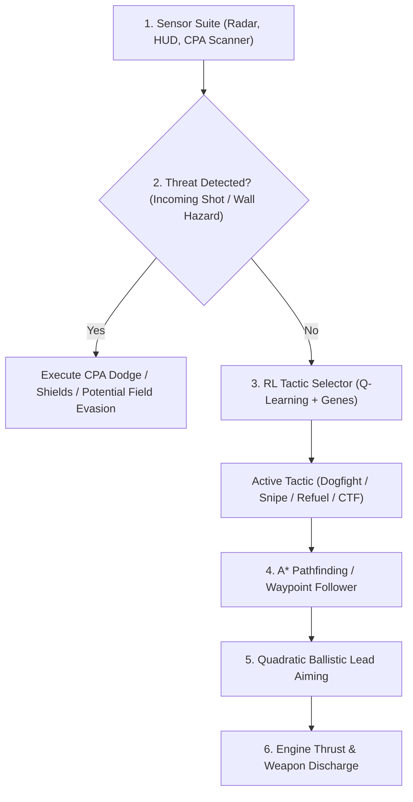

# 🤖 XPilot TNG Smartbots Documentation

XPilot TNG introduces **Smartbots** (`smart`), an advanced autonomous AI driver built into the game server (`src/server/smartbot.c`). Unlike classic scripted bots, Smartbots combine **exact ballistic lead prediction**, **A\* grid pathfinding**, **potential field collision evasion**, and a **hybrid online Reinforcement Learning (RL) brain** with persistent learning across server sessions.

---

## Table of Contents

1. [Overview & Features](#overview--features)
2. [Server Configuration & Startup Options](#server-configuration--startup-options)
3. [The Smartbot Roster](#the-smartbot-roster)
4. [In-Game Chat Commands](#in-game-chat-commands)
5. [AI Architecture & Core Capabilities](#ai-architecture--core-capabilities)
   - [Quadratic Ballistic Lead Prediction](#quadratic-ballistic-lead-prediction)
   - [Threat Scanner & CPA Evasion](#threat-scanner--cpa-evasion)
   - [A* Grid Pathfinding](#a-grid-pathfinding)
   - [Potential Field Maneuvering](#potential-field-maneuvering)
   - [Capture-the-Flag (CTF) Intelligence](#capture-the-flag-ctf-intelligence)
6. [Reinforcement Learning & Shared Brain](#reinforcement-learning--shared-brain)
   - [State & Action Space](#state--action-space)
   - [Evolutionary Policy Genes](#evolutionary-policy-genes)
   - [Brain Persistence (`smartbot_brain.dat`)](#brain-persistence-smartbot_braindat)
7. [Skill Level Matrix (Levels 1–100)](#skill-level-matrix-levels-1100)
8. [Tactical Advice for Human Pilots](#tactical-advice-for-human-pilots)

---

## Overview & Features

Classic XPilot robots rely on simple line-of-sight heuristics and fixed reaction timers. XPilot TNG Smartbots are engineered for modern competitive gameplay:

- **Mathematical Aiming:** Solves quadratic intercept equations factoring in relative vessel velocities, projectile speed, gravity, and toroidal world wrap.
- **Dynamic Threat Assessment:** Computes the *Closest Point of Approach (CPA)* for incoming bullets, smart missiles, and torpedoes to initiate micro-dodges and shield deployments.
- **Topological Navigation:** Navigates labyrinthine polygon and block maps using bounded grid A\* pathfinding to reach fuel stations, items, and team objectives.
- **Tactical Versatility:** Dynamically shifts between close-quarters dogfighting, long-range sniper kiting, survival evasion, harvesting/refueling, and CTF flag-running.
- **Online Learning:** Uses Tabular Q-Learning and continuous evolutionary policy adaptation that learns from combat outcomes (kills, deaths, damage) and persists across server runs in `smartbot_brain.dat`.

---

## Server Configuration & Startup Options

Smartbots can be enabled via command-line arguments or server defaults files (`defaults`):

### Server Options

| Option | Command Line Alias | Default | Description |
| :--- | :--- | :---: | :--- |
| `maxSmartRobots` | `-smartRobots` | `0` | Maximum number of smart learning robots active in the game. |
| `minSmartRobots` | `-minSmartRobots` | `-1` | Minimum number of smart robots kept in the server (`-1` = follow `maxSmartRobots`). |
| `smartRobotLevel` | `-smartLevel` | `75` | Global skill and intelligence level (**1 to 100**). Controls aiming precision, pathfinding depth, and reaction times. |

### Example Startup Commands

```bash
# 1. Start server with 4 Smartbots at default veteran skill (Level 75)
./xpilot-tng-server -map lib/maps/ndh.xp2 -smartRobots 4 -noQuit

# 2. Host a brutal training session with 6 Grandmaster Smartbots (Level 95)
./xpilot-tng-server -map lib/maps/ndh.xp2 -smartRobots 6 -smartLevel 95 -noQuit

# 3. Mix classic robots with smart learning bots
./xpilot-tng-server -map lib/maps/ndh.xp2 -robots 3 -smartRobots 3 -noQuit
```

> [!TIP]
> If human players leave, setting `-noQuit` keeps the server running so Smartbots can continue training against each other in the background.

---

## The Smartbot Roster

When spawned, Smartbots are assigned distinct names, custom ship geometries, and initial combat biases:

| Bot Name | Base Aggression / Defense | Ship Specialty |
| :--- | :---: | :--- |
| **`AlphaPilot`** | 90 / 80 | Balanced strike fighter with high turn agility |
| **`DeepThought`** | 75 / 85 | Defensive heavy hull; excels at sniper kiting |
| **`SHODAN`** | 95 / 75 | Aggressive hunter with high speed pursuit bias |
| **`HAL-9000`** | 80 / 90 | Methodical interceptor; prioritizes tactical positioning |
| **`Cortana`** | 85 / 80 | Swift dogfighter with reactive shield usage |
| **`Wintermute`** | 88 / 72 | High-speed flanking vessel |
| **`Siri`** | 82 / 88 | Defensive support craft and flag escort |
| **`GLaDOS`** | 70 / 95 | Fortified defensive tank; lethal counter-attacker |
| **`Skynet`** | 96 / 70 | Relentless forward assault drone |
| **`Ultron`** | 92 / 78 | Frontline brawler favoring close-range strafing |
| **`DeepMind`** | 86 / 86 | Highly adaptive tactical all-rounder |
| **`OmegaZero`** | 90 / 85 | High-velocity interceptor |

---

## In-Game Chat Commands

Players can interact with, inspect, and configure Smartbots in real-time through the in-game chat interface by sending private messages (default key: `m` or `/msg <BotName>`):

```text
/msg <BotName> status
/msg <BotName> level <1-100>
/msg <BotName> level 0
/msg <BotName> save
/msg <BotName> learn on
/msg <BotName> learn off
```

### Command Details

- **`/msg <BotName> status`**  
  Displays live diagnostics in the client console:
  - Effective skill level and individual override status.
  - Current tactical mode (`Dogfight`, `Snipe/Kite`, `Evade`, `Harvest/Fuel`, or `CTF`).
  - Total learning episodes completed.
  - Kill / Death ratio.
  - Current preferred combat distance.

- **`/msg <BotName> level <1-100>`**  
  Overrides the bot's skill level individually without affecting other bots on the server.
  *(Example: `/msg SHODAN level 100`)*.

- **`/msg <BotName> level 0`**  
  Resets the bot back to the global server `smartRobotLevel`.

- **`/msg <BotName> save`**  
  Immediately flushes and writes the shared reinforcement learning Q-table and evolutionary genes to `smartbot_brain.dat`.

- **`/msg <BotName> learn on` / `learn off`**  
  Enables or disables online reinforcement learning updates for this bot. Setting `learn off` forces pure exploitation of learned strategies.

---

## AI Architecture & Core Capabilities

Smartbots utilize a hierarchical decision pipeline executed every game tick:



### Quadratic Ballistic Lead Prediction

Rather than firing at an opponent's current location, the bot solves the interception equation:

$$\|\vec{r} + \vec{v}_{\text{rel}} \cdot t\|^2 = (v_{\text{projectile}} \cdot t)^2$$

Where:
- $\vec{r}$ is the relative displacement vector (adjusted for world wrapping).
- $\vec{v}_{\text{rel}} = \vec{v}_{\text{target}} - \vec{v}_{\text{shooter}}$.
- $v_{\text{projectile}}$ is the muzzle velocity (`options.shotSpeed` or `options.pulseSpeed`).

The solver computes the earliest positive root $t$. If the calculated intercept trajectory intersects a solid obstacle, higher-level bots abort the shot or maneuver into a clear line of sight.

### Threat Scanner & CPA Evasion

The Closest Point of Approach (CPA) scanner runs continuously:
- Evaluates trajectories of all active missiles, torpedoes, and cannon shots within sensor radius.
- Predicts whether an incoming hazard will enter the bot's collision bounding radius within $N$ frames.
- If an imminent hit is detected, the bot applies orthogonal thruster impulses and pulses emergency shields.

### A* Grid Pathfinding

On labyrinthine maps, direct vector flight leads to wall collisions. Smartbots implement a bounded grid A\* search:
- Discretizes the map into traversal blocks.
- Identifies paths around dead ends and narrow corridors.
- Caches up to 32 sequential waypoints for smooth navigation toward refueling depots, friendly home bases, or enemy treasures.

### Potential Field Maneuvering

Movement combines attractive and repulsive force vectors:
- **Attractive Vector:** Pulls the vessel toward the target or current A\* waypoint.
- **Wall Repulsion:** Increases exponentially as the bot approaches solid terrain.
- **Hazard Repulsion:** Pushes the bot away from floating mines, cannon fire, and asteroid fields.

### Capture-the-Flag (CTF) Intelligence

On maps with treasures/balls, Smartbots implement dedicated CTF heuristics:
- **Ball Stealing:** Prioritizes navigating to the enemy team's treasure vault.
- **Ball Carrying:** Modulates engine thrust to compensate for ball tether physics and inertia.
- **Catapulting & Throwing:** Flings the ball toward the scoring goal before reaching base.
- **Interception & Defense:** Targets enemy carriers to recover stolen treasures.

---

## Reinforcement Learning & Shared Brain

### State & Action Space

The Q-Learning agent discretizes environmental state into **72 states**:

- **Fuel Bins (3):** Critical ($<25\%$), Normal ($25\%-65\%$), High ($>65\%$).
- **Enemy Distance (4):** Close ($<6$ blocks), Medium ($<16$ blocks), Far, or None in sight.
- **Threat State (2):** Safe vs. Imminent projectile/wall hazard.
- **CTF Context (3):** Neutral, Carrying enemy ball, or Enemy carrying our ball.

The agent selects between **5 High-Level Tactics**:

1. `TACTIC_DOGFIGHT_AGGR` — Close-quarters pursuit, circle-strafing, and rapid fire.
2. `TACTIC_SNIPE_KITE` — Standoff range maintenance with precision lead shooting.
3. `TACTIC_EVADE_SURVIVE` — Shield conservation, defensive mine dropping, and retreat.
4. `TACTIC_HARVEST_REFUEL` — Seeking fuel stations and item concentrators.
5. `TACTIC_CTF_OBJECTIVE` — Attacking the enemy base, flag running, and escorting.

### Evolutionary Policy Genes

In addition to discrete tactics, each bot maintains continuous genetic parameters:

```c
typedef struct smart_genes {
    double preferred_combat_dist; /* Ideal combat distance in blocks (~8.5) */
    double evade_weight;          /* Weight of projectile repulsion (~1.4) */
    double wall_weight;           /* Weight of wall repulsion (~1.5) */
    double aggression_bias;       /* Attack vs. harvest preference (~1.0) */
    double speed_factor;          /* Flight speed cruising multiplier (~1.1) */
} smart_genes_t;
```

Bots receiving high episode rewards (kills, CTF captures, survival) propagate their gene weights to the shared server brain.

### Brain Persistence (`smartbot_brain.dat`)

- All smartbots on a server share a single persistent brain.
- At the end of matches, upon server shutdown, or when `/msg <BotName> save` is issued, the state table and optimal policy genes are written to `smartbot_brain.dat`.
- When the server boots up, existing knowledge is loaded automatically, preventing bots from having to relearn basic tactics.

---

## Skill Level Matrix (Levels 1–100)

The `smartRobotLevel` option scales AI behavior across several parameters:

| Level Bracket | Aiming Lead Accuracy | Aiming Jitter | Wall LOS Checking | A* Path Recomputation | Evasion & CPA |
| :---: | :---: | :---: | :---: | :---: | :---: |
| **1 – 30** *(Rookie)* | 25% – 45% velocity lead | $\pm 8^\circ$ | Disabled | Every 30 ticks | Basic wall bounce avoidance |
| **31 – 60** *(Skilled)* | 50% – 70% velocity lead | $\pm 4^\circ$ | Enabled ($\ge 50$) | Every 20 ticks | Active projectile dodges |
| **61 – 85** *(Veteran)* | **75% – 88% lead** *(Default)* | **$\pm 1.5^\circ$** | **Enabled** | **Every 18 ticks** | **Coordinated dodging & shields** |
| **86 – 100** *(Master)* | 90% – 100% exact lead | $0^\circ$ (Pinpoint) | Enabled | Real-time adaptive | Frame-perfect evasion & kiting |

---

## Tactical Advice for Human Pilots

Smartbots are formidable opponents, but human pilots can exploit their algorithmic nature:

1. **Break Velocity Continuity:** Smartbots predict your movement assuming linear velocity. Rapid thruster tap-dancing, reverse burns, and sharp directional feints cause their lead shots to miss.
2. **Deploy Countermeasures:**
   - **ECM (`d`):** Blinds the bot's targeting radar and scrambles smart missile locks.
   - **Cloak (`c`):** Prevents bots from acquiring lock-on firing solutions.
   - **Phasing (`p`):** Dive through solid rock walls where bots are forced to take the long A\* path around.
3. **Exploit Fuel Depletion:** Watch for bots entering `Harvest/Refuel` mode. When a bot is low on fuel, it prioritizes fuel depots and becomes vulnerable to ambushes.
4. **Use Obstacles:** Ricochet shots around corners; while Smartbots understand wall avoidance, human players can set traps using stationary mines and gravitational wells.
